# CEERS NIRCam3 F150W: reduction progress and figure explanations

I reproduced the CEERS DR0.5 reduction for **NIRCam Pointing 3 in the F150W filter**, starting from 24 raw detector exposures and producing a calibrated mosaic. I used the supplied reduction package, Bagley's reduction scripts, and the pinned JWST calibration environment. I then compared the final mosaic with the official CEERS DR0.5 product and assembled the figures and measurements in this folder.

**Current status:** computational steps **00–21 are complete**, according to the saved completion records. This includes detector corrections, image calibration, application of the saved astrometric solution, outlier detection, sky and variance corrections, mosaicking, comparison, and figure generation. The quantitative results show close agreement with official DR0.5; the mosaics are not bit-identical.

## Observations and software

| Item | Configuration used |
|---|---|
| Survey and field | Cosmic Evolution Early Release Science Survey (CEERS), Extended Groth Strip |
| JWST program | PID 1345 |
| Pointing and filter processed | NIRCam Pointing 3, F150W |
| Input files | 24 `_uncal.fits` exposures: eight short-wavelength detectors at three dither positions |
| Detectors | NRCA1–NRCA4 and NRCB1–NRCB4 |
| Exposure pattern in the example raw header | MEDIUM8; one integration; nine groups; eight frames per group |
| Example exposure date and effective exposure time | 2022-06-22; 944.836 seconds per exposure in the example header |
| Python / JWST pipeline | Python 3.9.25 / `jwst` 1.7.2 |
| Other pinned packages | `crds` 11.16.9, `stcal` 1.1.0, `stdatamodels` 0.4.3, `photutils` 1.5.0 |
| Calibration context | `jwst_0989.pmap` |
| Reduction code | Bagley `ceers-nircam`, commit `8713c4d53e67533c657543b85c01bb1cbb199557` |
| Wisp templates | STScI release `wisps_2022_08_26` |
| Final mosaic | `ceers_nircam3_f150w_dr05_i2d.fits` |
| Mosaic grid | 10,500 columns × 4,800 rows; 0.03 arcsec per pixel |

The eight detector exposures at a given dither cover different parts of the sky. Adding all 24 exposure times would therefore not give the exposure time at a single sky position. Coverage and weights vary across the mosaic.

## What I have completed

The numbered local steps 00–21 include setup checks, pilot runs, full runs, and validation. They implement the following scientific processing sequence:

| Processing stage | Work completed | Main product or check |
|---|---|---|
| Input and calibration checks | Checked the input manifest, pinned software, and calibration references before processing. | 24 input exposures and the required CRDS references |
| Stage 1: detector corrections | Ran Detector1 processing with the supplied snowball treatment, including jump detection and ramp fitting. | Corrected ramps, quality flags, and `_rate.fits` count-rate images |
| Wisp subtraction | Applied the supplied scaled wisp templates to A3, A4, B3, and B4 exposures. | Corrected rate images; `_rate_prewisp.fits` backups |
| 1/f noise correction | Removed row and column striping with the supplied source masking and remstriping procedure. | Final `_rate.fits`; pre-correction images and masks |
| Stage 2: individual image calibration | Applied flat-field and photometric calibration to the corrected rate images. | `_cal.fits` images in MJy/sr |
| Astrometric update | Applied Bagley's saved TweakReg WCS solution to each exposure. | `_tweakreg.fits` images with updated sky coordinates |
| Stage 3: ensemble outlier detection | Ran SkyMatch and OutlierDetection across the exposures. | `_a3001_crf.fits` products and new outlier flags |
| Sky and variance corrections | Estimated exposure-level 2D backgrounds for sky-variance measurement, subtracted a scalar sky pedestal, rescaled read-noise variance, and treated zero-variance holes. | `_a3001_bkgsub1.fits` diagnostics and `_a3001_match.fits` inputs for mosaicking |
| Mosaicking | Combined the 24 corrected exposures using drizzle on the DR0.5 grid, with 0.03 arcsec pixels and `pixfrac=1`. | Final `_i2d.fits` mosaic with science, error, and weight information |
| Comparison and reporting | Compared grid, coverage, pixel values, source fluxes, centroids, and empty-aperture noise with official DR0.5. Generated 15 main figures and four additional comparison plots. | Reports, JSON measurements, and 19 PNG figures |

The astrometric stage reused an existing saved solution; I did not solve the astrometry independently from a new external catalogue in this run. The underlying reduction methods and custom correction scripts are credited to Bagley and the CEERS team.

## Comparison with official DR0.5

The comparison uses the official mosaic's **`SCI` extension**, which corresponds to the output of this run's mosaicking stage. Bagley's separate final mosaic-background procedure, which produces `SCI_BKSUB` using information from all seven NIRCam filters plus HST, was not independently run for this single-filter reproduction.

The main quantitative comparison covers the full common valid footprint, without reprojecting either mosaic. A valid covered pixel has positive weight and a finite science value.

| Measurement | Result |
|---|---|
| Pixel grid | Identical dimensions and WCS in the comparison checks; maximum tested corner/centre sky offset 0 mas |
| Covered pixels, reproduction / official | 37,000,293 / 37,000,257 |
| Common coverage | 100% of the official covered footprint; 36 additional covered pixels in the reproduction |
| Median science difference, reproduction − official | −1.294 × 10⁻⁵ MJy/sr |
| NMAD of science differences | 3.066 × 10⁻⁴ MJy/sr |
| Difference NMAD / official sky sigma | 0.0429 |
| Pixels with absolute difference below 0.1 sky sigma | 91.28% |
| Median source flux ratio, reproduction / official | 1.0003; NMAD 0.0042, using 2,143 sources with S/N > 10 |
| Photometry aperture | 0.2 arcsec radius, with the same reference-derived positions in both mosaics |
| Median centroid offsets, dx / dy | Approximately −0.0022 / +0.0020 mas |
| Centroid NMAD, dx / dy | 0.0748 / 0.1018 mas, using 870 sources with S/N > 30 |
| Median error ratio, reproduction / official | 1.0058 |
| Median weight ratio, reproduction / official | 0.9791 |
| Empty-aperture noise ratio | 1.0097, from 5,000 apertures of 0.1 arcsec radius |
| Empty-aperture 5-sigma depth | 29.19 AB in the reproduction; 29.20 AB in official DR0.5 |

These checks support close reproduction of the official image: the median source flux is about 0.03% higher, the empty-aperture noise is about 0.97% higher, and the measured aperture depth is about 0.01 mag shallower. The quoted depth is for the stated aperture and measurement procedure; it is not an aperture-corrected total-source magnitude limit. The centroid statistics measure agreement between these two reductions, not absolute astrometric accuracy against an independent sky reference.

The full results and selection details are in [the comparison report](reports/COMPARISON.md) and [comparison metrics](measurements/comparison_metrics.json).

## Validation against the supplied reference reproduction

The package also contains a previously completed reference reproduction. This is a separate comparison from the test against the official DR0.5 mosaic above.

According to the [saved completion report](reports/COMPLETION.md) and [verification record](measurements/verification.json):

- All computational status records are `COMPLETE` or `SKIPPED_VERIFIED_EXACT`.
- The final scientific figure measurements match the supplied reference `numbers.json` exactly.
- Fourteen of the 15 main PNG figures are byte-identical to the reference figures.
- F12 differs in four of 2,461,967 image pixels, with a maximum channel difference of 3 on the 0–255 scale; its recorded scientific measurements match.
- The original official-comparison report text matches the reference report. In this packaged folder, its image links were changed to portable relative links.
- The final FITS mosaic is not bit-identical to the reference reproduction. Matching figure numbers and rendered PNGs does not imply equality of every FITS pixel or extension.

## How to read the figures

**DN** is the detector's digital signal unit; **DN/s** is a fitted count rate. **MJy/sr** is the surface-brightness unit of the calibrated science images. **SCI** denotes science data, **DQ** data-quality flags, **ERR** estimated pixel uncertainty, and **WHT** the drizzle weighting information. **WCS** maps image pixels to sky coordinates. A **mas** is a milliarcsecond.

**NMAD** is a robust measure of scatter: `1.4826 × median(|x − median(x)|)`. A flux, weight, or error ratio of one means equality between the reproduction and official DR0.5. Red and blue residuals show the sign of a difference, as defined in each caption.

Some figures show one representative detector exposure; the final mosaic and ensemble checks use all 24 exposures. Images binned for display retain the original scientific sampling in the FITS data. Figures F11–F14 use a robust NMAD-based reference-image scale, while the full-comparison script uses a sigma-clipped reference sky standard deviation. This explains why F14 reports about 0.0419 sigma and the full comparison reports about 0.0429 sigma. F13's displayed ratio medians are also based on 16 × 16 binned ratio maps, whereas the full comparison uses individual valid pixels.

## Figure explanations

### 01 — F00: CEERS field, Pointing 3, and dither coverage

The left panel places Pointing 3 within the ten CEERS NIRCam pointings in the Extended Groth Strip. The 288 exposure footprints shown there come from the supplied field database and footprint table; only Pointing 3's 24 exposures were reduced in this work. The red outline identifies the pointing processed here.

The right panel overlays those 24 detector footprints on the final F150W mosaic: eight detectors across modules A and B, each observed at three dither positions. Colours identify the dithers, and the inset enlarges an A3 corner to make their small offsets visible. Relative to dither 1, the plotted mosaic-axis offsets are approximately (−0.29, −0.84) arcsec and (+0.29, +0.84) arcsec. The gaps and limited dither offsets explain the disconnected detector footprints in the mosaic.

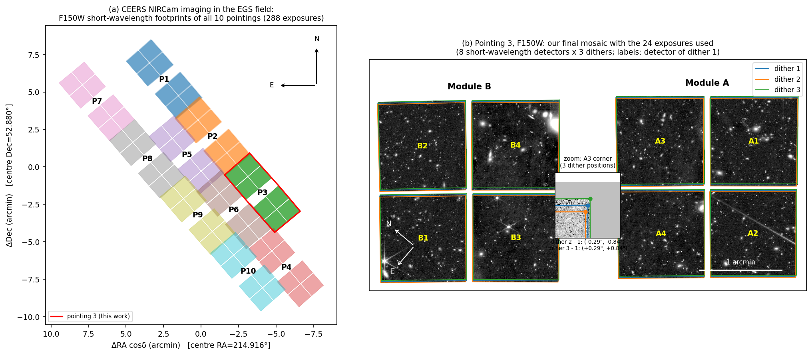

### 02 — F01: Reduction workflow

This flowchart follows the data from raw Level-1b ramps to the final comparison. It shows where Detector1, Image2, SkyMatch, OutlierDetection, and drizzle are used, and where the supplied wisp, remstriping, WCS, and sky/variance corrections enter.

The colours distinguish the raw input, JWST pipeline processing, Bagley's custom procedures, and the comparison performed for this reproduction. Use it as a guide to the order of the remaining figures and to the file suffixes in the processing table above.

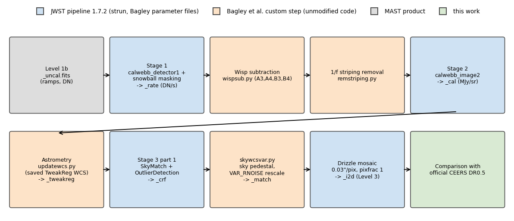

### 03 — F02: Raw detector ramps and a cosmic-ray jump

The detector image is the last raw group minus the first raw group for an NRCA1 exposure. Three marked pixels are followed through the nine groups: a sky pixel, a bright unsaturated source pixel, and a pixel with a detected cosmic-ray jump. The curves show accumulated signal relative to the first group against time.

A larger slope corresponds to a larger count rate. The discontinuity in the cosmic-ray example demonstrates why a simple end-minus-start estimate can be biased and why jump detection and ramp fitting are needed. Crosses mark groups with `JUMP_DET` flags. These are raw-ramp diagnostics, before the conversion to calibrated surface brightness.

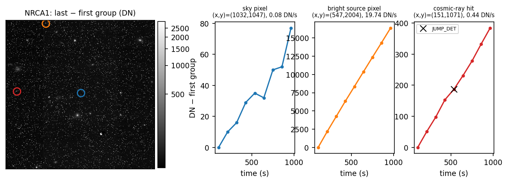

### 04 — F03: Stage 1 rate image and snowball-related flags

The panels show the NRCA1 Stage 1 rate image, a map of pixels flagged `JUMP_DET` in at least one group, and enlarged views around the largest connected flagged region. The example rate image is taken before 1/f removal; NRCA1 has no wisp-subtraction step.

About **14.86%** of detector pixels carry a jump flag in at least one group in this example, and the largest connected flagged region covers **12,108 pixels**. These are quality-flag statistics across the integration. They do not mean that 14.86% of the final mosaic was discarded, or that each connected region is an independently identified cosmic-ray event. The enlarged panels illustrate the extent of the snowball-related masking.

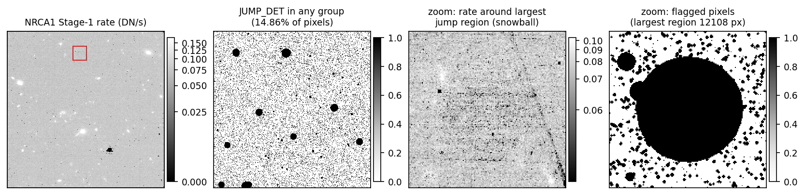

### 05 — F04: Wisp subtraction

This example uses NRCB4, selected by the plotting routine as the strongest smoothed wisp-model example among the first-dither A3, A4, B3, and B4 exposures. The panels show the rate image before correction, after correction, and their difference. The difference is the scaled template that was subtracted, in DN/s.

The matched display stretch in the first two panels helps isolate the change in the broad detector pattern. The smoothed standard deviation of the removed template is about **0.00227 DN/s**. It describes the amplitude of the displayed correction, rather than a measurement of the remaining wisp contamination.

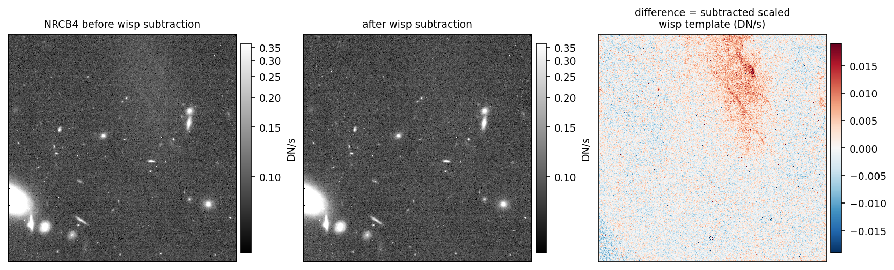

### 06 — F05: Removal of 1/f row and column striping

The top row compares NRCA1 before and after remstriping and shows the removed row-plus-column pattern. The lower plots compare masked row and column medians before and after correction; dotted vertical lines identify amplifier boundaries in the column plot. Source masking reduces the influence of astronomical objects on the pattern estimate.

For this exposure, the standard deviation of the plotted row medians falls from **0.002890 to 0.002611 DN/s**, a reduction of about **9.66%**. The column-median scatter falls from **0.001140 to 0.000755 DN/s**, about **33.81%**. These percentages describe the plotted masked median profiles, not the total image noise or the final mosaic depth.

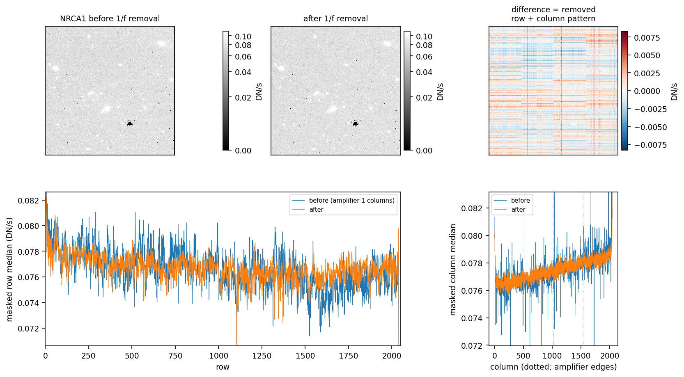

### 07 — F06: Flat-field and photometric calibration

The first panel shows the corrected NRCA1 rate in DN/s; the second shows the Stage 2 `_cal` image in MJy/sr. The third maps `cal / rate` where the rate is sufficiently far from zero to form a useful ratio.

The spatial variation reflects the combined flat-field and photometric conversion. In this example, the header value `PHOTMJSR` is about **2.2512**, and the median displayed conversion is about **2.2310 MJy/sr per DN/s**. The ratio is not spatially constant because flat-fielding accounts for pixel-to-pixel response differences.

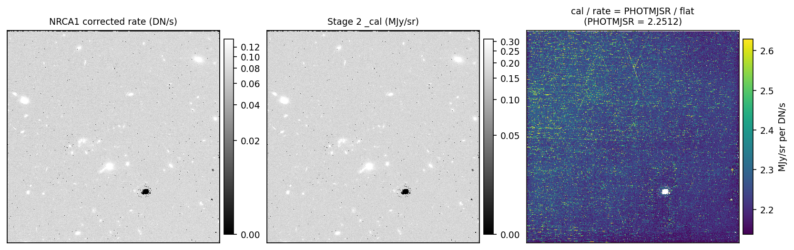

### 08 — F07: Applied astrometric corrections

The left panel places arrows at the detector centres to show the sky-coordinate corrections applied by `updatewcs.py`; colours distinguish the dithers. The arrow lengths are enlarged according to the scale stated on the plot. The right panel shows the correction components in milliarcseconds for all 24 exposures.

The correction magnitudes range from approximately **21.75 to 76.16 mas**, with a median of **49.48 mas**. These are the applied corrections from Bagley's saved WCS solution. They are not the remaining positional errors after alignment; the final relative centroid check is shown in Figure 19.

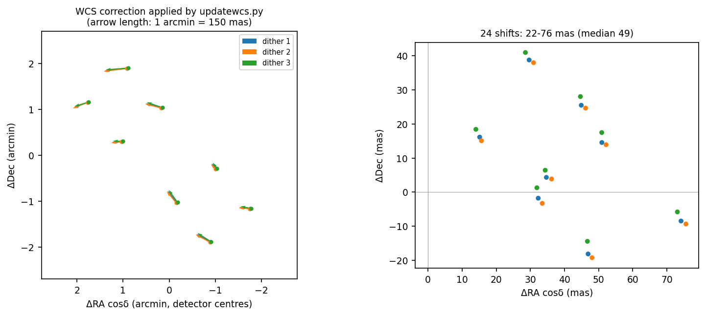

### 09 — F08: Ensemble outlier detection

Red marks identify pixels newly assigned the `OUTLIER` bit during ensemble processing. The enlarged views show an example region before the new flags and with the flags overlaid. The bar chart compares the fraction of newly flagged pixels across all 24 exposures.

The illustrated NRCA1 exposure has about **0.787%** newly flagged pixels. Across the ensemble, the saved fractions range from about **0.344% to 0.787%**. Comparing overlapping exposures identifies inconsistent samples, which can then be excluded during combination. The red overlay displays quality flags; it does not represent a replacement science image with all flagged values removed.

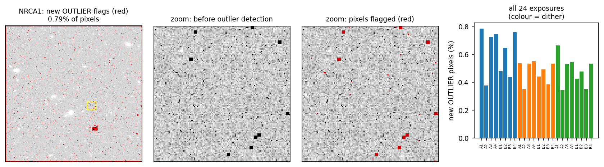

### 10 — F09: Sky pedestal and variance corrections

The panels show the example exposure's masked sky-value distribution, its estimated 2D background model, the locations of variance holes, and the pedestal/variance-scale diagnostics for all 24 exposures. For the NRCA1 example, the estimated subtracted pedestal is about **0.1743 MJy/sr**, and the median read-noise variance scaling factor is about **9.07**.

The 2D-background-subtracted `_bkgsub1` image is used to estimate sky variance. The `_match` science image used for mosaicking receives the scalar pedestal subtraction. These serve different purposes. In this example, **45,264** zero-read-noise-variance pixels become infinite-variance holes, preventing them from acquiring misleadingly high inverse-variance weights. The factor 9.07 applies to `VAR_RNOISE`, not directly to the final total `ERR` or to its standard deviation.

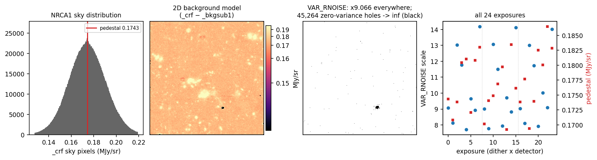

### 11 — F10: Final science mosaic, weights, and errors

The three panels show the final science surface brightness (`SCI`), drizzle weighting information (`WHT`), and estimated uncertainty (`ERR`). The FITS mosaic has **10,500 × 4,800 pixels at 0.03 arcsec per pixel**; this figure is cropped to the covered region and averaged in 4 × 4 blocks for display.

The reproduction contains **37,000,293 covered pixels**. Blank gaps follow the detector layout and the observation's limited dithering. Weight variations indicate differing contributions to the combined image, while the error panel shows how the estimated uncertainty varies spatially. The displayed binning changes the visualization, not the resolution of the saved mosaic.

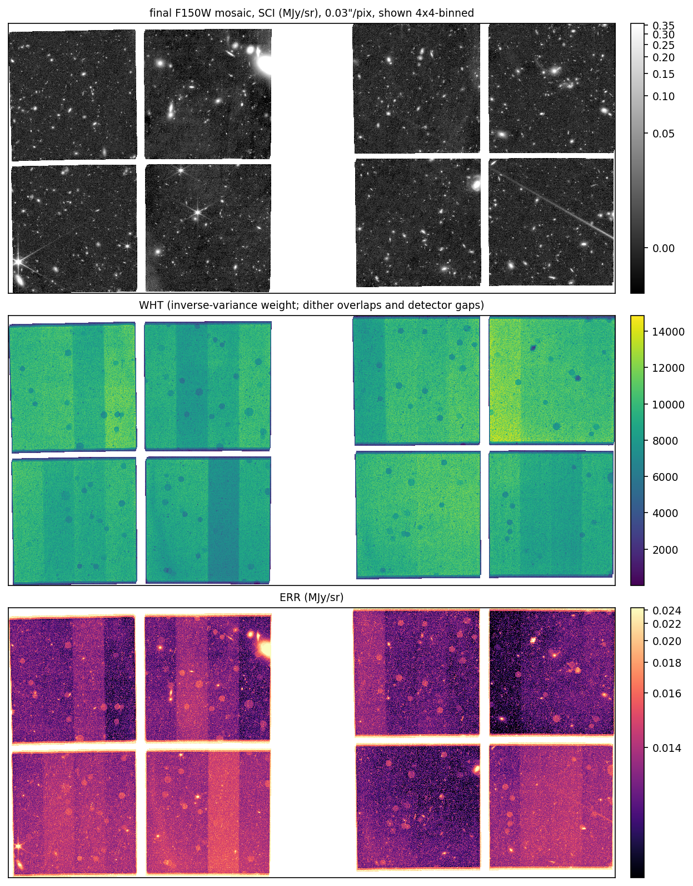

### 12 — F11: Full-field comparison with official DR0.5

The first two panels show the reproduction and official `SCI` mosaics using the same stretch; the third shows **reproduction − official**. The images are averaged in 6 × 6 blocks for display over the common covered footprint. The residual colour range is deliberately narrow: approximately ±0.1 of the figure's reference noise scale.

This checks whether spatial structures or detector-scale patterns differ across the field. Small positive and negative residuals become visible even when the science images look alike. The normalization here uses the NMAD-based figure scale described above; the full-comparison statistics in the results table use the comparator's sigma-clipped sky scale.

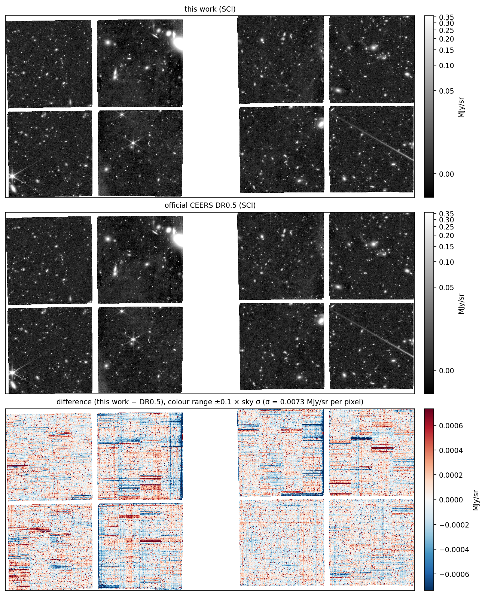

### 13 — F12: Detailed comparison cutouts

Each row compares a **300 × 300 pixel region, or 9 × 9 arcsec**, in the reproduction, official DR0.5, and their difference. The selected examples are labelled field centre, brightest source, largest absolute difference, and galaxy-rich region. These are diagnostic locations chosen by the plotting routine, rather than an unbiased source sample.

The respective difference NMADs are approximately **0.0362, 0.0540, 0.0446, and 0.0372** times the figure's reference noise scale. The difference panels use ±0.2 of that scale. These cutouts help reveal local offsets, source-shape differences, or residual backgrounds that would be harder to inspect in a full-field image.

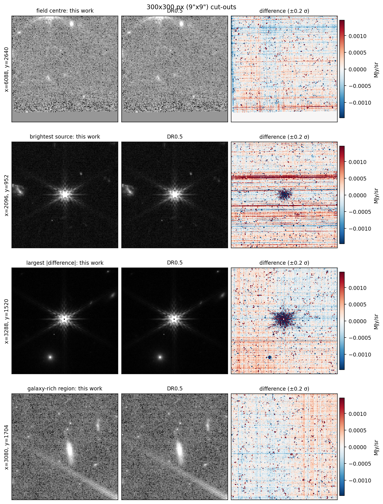

### 14 — F13: Weight- and error-ratio maps

The upper panel maps **WHT reproduction / official**, and the lower panel maps **ERR reproduction / official**. The ratio maps are averaged in 16 × 16 blocks for display. Values near one indicate agreement; spatial changes help locate variations in weighting or uncertainty between the reductions.

The medians of the displayed binned maps are approximately **0.9810 for WHT** and **1.0054 for ERR**. These differ slightly from the full-resolution comparison values of **0.9791** and **1.0058** because the aggregation differs. The maps concern weights and uncertainty estimates, not a multiplicative correction to the source fluxes.

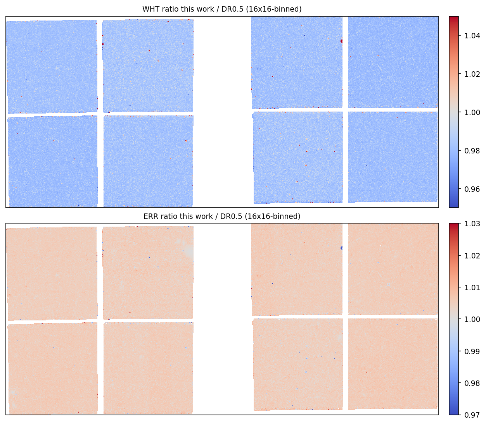

### 15 — F14: Distributions of pixel differences and uncertainty ratios

The left histogram shows individual science-pixel differences divided by the figure's reference noise scale, with a logarithmic count axis. Its NMAD is about **0.0419** in that normalization. The right panel compares the distributions of the 16 × 16 binned WHT and ERR ratios shown in F13.

The distributions summarize the spatial maps and show both central agreement and tails. The plotted science differences are clipped to ±1, and the plotted ratios are clipped to 0.9–1.1. Values accumulated at the limits therefore include points beyond those limits; the plot does not establish that every difference or ratio lies inside the displayed range.

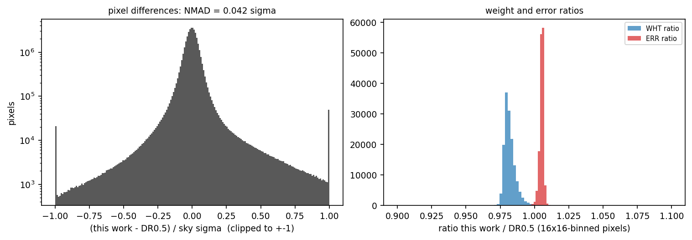

### 16 — Additional comparison: science images and difference

This three-panel figure comes directly from the full-comparison script. It shows the reproduction, official `SCI`, and their difference side by side, averaged in 6 × 6 blocks over the common region. The science panels share a linear display stretch; the residual panel spans approximately ±1 sigma using the comparator's sigma-clipped reference sky estimate.

It provides a complementary view to F11, whose residual stretch is tighter. Interpret the apparent strength of residual structure together with the colour-bar range and the numerical difference statistics.

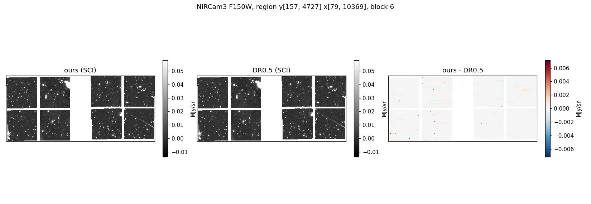

### 17 — Additional comparison: pixel-difference histogram

This histogram uses all **37,000,257 common covered pixels** and plots `(reproduction − official) / sky sigma` with logarithmic counts. Unlike F14, its denominator is the full-comparison script's sigma-clipped reference sky standard deviation. The resulting difference NMAD is **0.0429 sigma**.

The median difference is **−1.294 × 10⁻⁵ MJy/sr**, and **91.28%** of common pixels differ by less than 0.1 sigma in absolute value. Values are clipped to ±1 for plotting, so the endpoint bins include more extreme residuals. The unrounded measurements are stored in `comparison_metrics.json`.

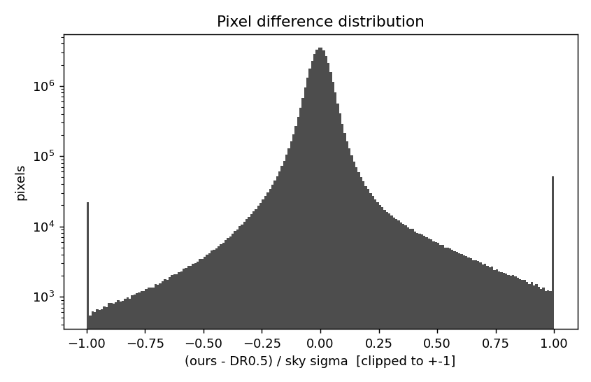

### 18 — Additional comparison: source flux ratio against magnitude

Each point compares aperture fluxes measured at the same reference-derived position in the two mosaics. The horizontal axis is the official F150W AB aperture magnitude; the vertical axis is **reproduction flux / official flux**. The sample uses 0.2 arcsec radius apertures and S/N > 10, yielding **2,143 sources** after the comparison selections.

The horizontal line at one marks equal flux. Red points show medians in the stated magnitude bins, and their bars show NMAD scatter, rather than uncertainty on the median. The overall median ratio is **1.0003**, with NMAD **0.0042**. The bin medians test for a brightness-dependent offset; the scatter broadens toward fainter sources. This is a reproduction-consistency check, not an independent determination of the absolute photometric calibration.

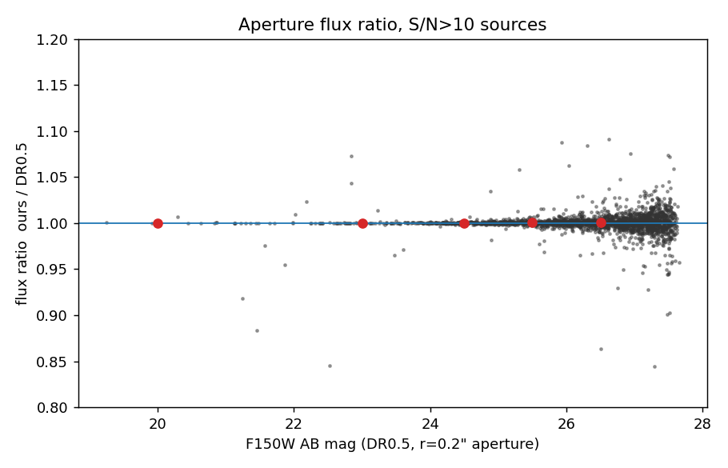

### 19 — Additional comparison: source centroid offsets

This scatter plot shows **dx and dy = reproduction centroid − official centroid** in milliarcseconds for **870 sources with S/N > 30**. Centroids are measured from the two images at the selected reference positions using the comparison script's centre-of-mass procedure. Lines through zero mark exact relative agreement.

The median offsets are approximately **−0.0022 mas in x** and **+0.0020 mas in y**. Their NMADs are **0.0748 and 0.1018 mas**, respectively. This demonstrates close relative agreement after applying the saved astrometric solution and using the same mosaic grid. It does not measure absolute accuracy against Gaia or another independent catalogue.

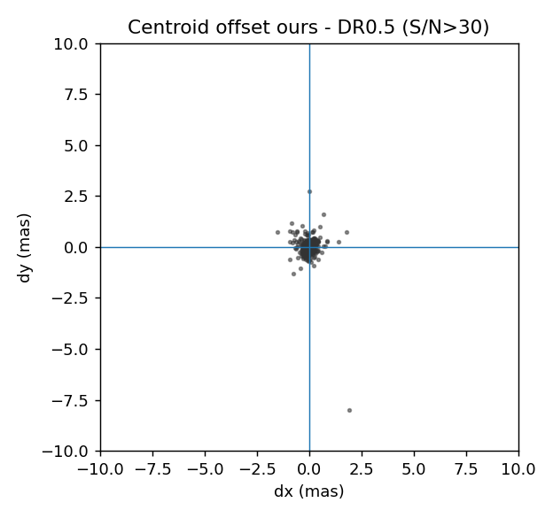

## Files and provenance

| Path | Contents |
|---|---|
| `figures/` | 19 individual numbered PNGs; 01–15 correspond to F00–F14 |
| [reports/COMPARISON.md](reports/COMPARISON.md) | Full-overlap comparison report |
| [reports/COMPLETION.md](reports/COMPLETION.md) | Saved computational completion and validation report |
| [measurements/figure_numbers.json](measurements/figure_numbers.json) | Measurements recorded by the main-figure script |
| [measurements/comparison_metrics.json](measurements/comparison_metrics.json) | Detailed grid, pixel, source, centroid, and noise statistics |
| [measurements/verification.json](measurements/verification.json) | Saved verification against the supplied reference reproduction |
| [RESULTS.csv](RESULTS.csv) | Figure numbers, paths, sizes, and SHA-256 checksums |
| [SHA256SUMS](SHA256SUMS) | Checksums for packaged files |
| [data/README.md](data/README.md) | Information about the separately stored 1.41 GB final FITS mosaic |

Run identifier: `dr05_py39_jwst172_crds0989`. The final source directories are `report/figures_full_L20261117005919` and `comparison/full_L20261117005708`. PNG and JSON products in this folder were copied unchanged from that completed run. JSON input paths record the original processing machine and are provenance, rather than portable download links.

The final FITS mosaic, raw exposures, intermediate FITS files, calibration cache, and Python environment remain with the reduction package. This results folder provides the figures, numerical summaries, and explanations for review.

## Remaining work

The computational reduction and comparison are complete. The remaining guide tasks are to review the figures and comparison with Brenjit and prepare the requested 2–3 page write-up in my own words. This README documents the completed work and the meaning of the figures; it does not record those review discussions as completed.

## References and credits

The reduction procedures and supplied scripts are from the CEERS team. This work applies them to the stated single-pointing, single-filter reproduction and documents its validation.

- [Bagley et al. (2023), *CEERS Epoch 1 NIRCam Imaging: Reduction Methods and Simulations Enabling Early JWST Science Results*](https://arxiv.org/abs/2211.02495), ApJL 946, L12; [DOI](https://doi.org/10.3847/2041-8213/acbb08).
- [CEERS DR0.5 release](https://ceers.github.io/dr05.html), the official comparison target and release documentation.
- [CEERS NIRCam reduction code at the pinned commit](https://github.com/ceers/ceers-nircam/tree/8713c4d53e67533c657543b85c01bb1cbb199557).
- [CEERS high-level science products at MAST](https://archive.stsci.edu/hlsp/ceers).
